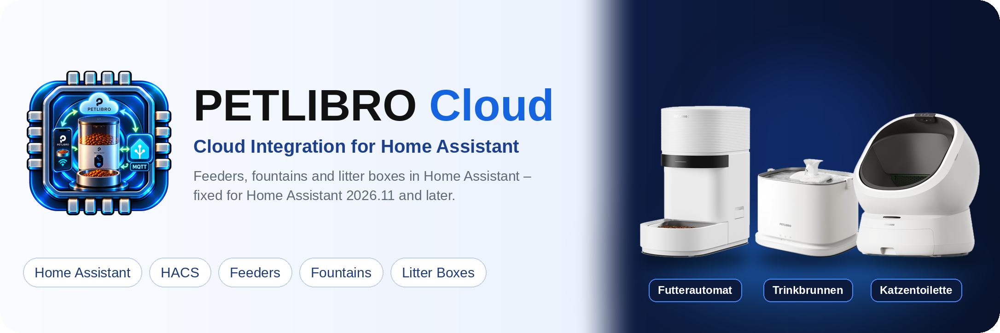

# PETLIBRO

**PETLIBRO-Futterautomaten, Trinkbrunnen und Katzentoiletten über die PETLIBRO-Cloud in Home Assistant.**

[](https://github.com/dhaucke/petlibro/releases/latest)
[](https://github.com/hacs/integration)
[](https://www.home-assistant.io/)
[](https://github.com/dhaucke/petlibro/blob/dev/LICENSE)

[Mit HACS installieren](https://my.home-assistant.io/redirect/hacs_repository/?owner=dhaucke&repository=petlibro&category=integration) · [Problem melden](https://github.com/dhaucke/petlibro/issues)

**Sprache:** [Deutsch](#warum-dieser-fork-existiert) · [English](#why-this-fork-exists)

## Warum dieser Fork existiert

Dies ist ein Fork von [jjjonesjr33/petlibro](https://github.com/jjjonesjr33/petlibro). Seit Home Assistant 2026.11 startet das Original nicht mehr, die fertigen Korrekturen aus der Community liegen dort aber ungemergt. Dieser Fork übernimmt sie:

- **Einrichtung scheitert auf HA 2026.11**: `dataclass` wurde aus `homeassistant.components.sensor` importiert, das HA dort nie offiziell angeboten hat und seit 2026.11 nicht mehr enthält. Sieben Plattform-Module brachen mit `ImportError` ab, die Integration meldete nur „Failed to set up the config entry“ ([#294](https://github.com/jjjonesjr33/petlibro/issues/294), [PR #298](https://github.com/jjjonesjr33/petlibro/pull/298)).
- **Veraltete Geräte-Abfrage**: `DeviceRegistry.async_get_device` hört in HA 2027.8 auf zu funktionieren; ersetzt durch eine Abfrage über die Geräte des eigenen Konfigurationseintrags ([PR #298](https://github.com/jjjonesjr33/petlibro/pull/298)).
- **Warnung im Optionsdialog**: `step_id` wird jetzt explizit übergeben, wie HA es ab 2027.5 verlangt ([PR #291](https://github.com/jjjonesjr33/petlibro/pull/291)).

Die Domain bleibt `petlibro`: Wer vom Original in HACS auf diesen Fork wechselt, behält Konto, Geräte und Entitäten, ohne neu einzurichten. Ansonsten unverändert gegenüber dem Original.

## Why this fork exists

This is a fork of [jjjonesjr33/petlibro](https://github.com/jjjonesjr33/petlibro). Since Home Assistant 2026.11 the original fails to start, while the finished community fixes sit unmerged there. This fork adopts them:

- **Setup fails on HA 2026.11**: `dataclass` was imported from `homeassistant.components.sensor`, which never officially provided it and no longer does since 2026.11. Seven platform modules failed with `ImportError`, and the integration only reported "Failed to set up the config entry" ([#294](https://github.com/jjjonesjr33/petlibro/issues/294), [PR #298](https://github.com/jjjonesjr33/petlibro/pull/298)).
- **Deprecated device lookup**: `DeviceRegistry.async_get_device` stops working in HA 2027.8; replaced by a lookup over the config entry's own devices ([PR #298](https://github.com/jjjonesjr33/petlibro/pull/298)).
- **Options flow warning**: `step_id` is now passed explicitly, as HA requires from 2027.5 ([PR #291](https://github.com/jjjonesjr33/petlibro/pull/291)).

The domain stays `petlibro`: switching from the original in HACS keeps your account, devices and entities without setting anything up again. Otherwise unchanged from upstream.

---

> [!IMPORTANT]  
> Before setting up the integration in Home Assistant, be sure to review the [Account Management](https://github.com/jjjonesjr33/petlibro/wiki/PetLibro-Account-Management) and [Password Limitations](https://github.com/jjjonesjr33/petlibro/wiki/PetLibro-Password-Limitation) sections in the wiki. This will help ensure a smooth and successful setup process.
---

### Account Integration
#### Manage your Petlibro account directly within Home Assistant

* View account information (email, username, region, subscription status)
* Update profile details
* Configure time zone and language preferences
* Manage linked devices at the account level
* Access support and diagnostic information
* Options Flow in Home Assistant (⚙️ Configure button) for account settings

### Supported Devices
#### This has been reworked to work with the following devices

### Feeders
* Granary Smart Feeder (PLAF103) | Version 2
* Space Smart Feeder (PLAF107)
* Air Smart Feeder (PLAF108)
* Polar Wet Food Feeder (PLAF109)
* Granary Smart Camera Feeder (PLAF203)
* One RFID Smart Feeder (PLAF301)

### Fountains
* Dockstream Smart Fountain (PLWF105)
* Dockstream RFID Smart Fountain (PLWF305)
* Dockstream 2 Smart Fountain | Plug-In Model (PLWF106) 
* Dockstream 2 Smart Fountain | Cordless Model (PLWF116)

### Litter Boxes
* Luma Smart Litter Box (PLLB001)

### Pending Device(s)

### Some Devices / May or may not work as intended

* If you have a device that you would like added please issue a [request](https://github.com/dhaucke/petlibro/issues).

# Have questions, or need support?
> [!TIP]
>* Most answers can be found in our [Wiki](https://github.com/jjjonesjr33/petlibro/wiki)
> and if they can't, try the [Discussions](https://github.com/jjjonesjr33/petlibro/discussions)
>* Problems with this fork: [Issues](https://github.com/dhaucke/petlibro/issues)


# NOTICE
#### Alpha/Beta state notice for this plugin:
> [!WARNING]
>* When setting up for the first time, please sign in and allow 1-5 minutes for the login process and data retrieval to complete. If you do not see all the sensors and controls listed, you may need to refresh your web browser's cache.
>* I recommend performing a full reboot of Home Assistant to ensure you are logged in and that the add-on has refreshed the data without any errors. 
>* The addon is programmed to update every 60 seconds.

## Troubleshooting
To troubleshoot your Home Assistant instance, you can add the following configuration to your configuration.yaml file:

```yaml
logger:
  default: warning  # Default log level for all components
  logs:
    custom_components.petlibro: debug    # Enable debug logging for your component
```

## Installation (Automatic)
> [!IMPORTANT]
> This is a HACS custom integration — not a Home Assistant Add-on. Don't try to add this repository as an add-on in Home Assistant.
> 
> The IMHO simplest way to install this integration is via the two buttons below ('_OPEN HACS REPOSITORY ON MY HA_' and '_ADD INTEGRATION TO MY HA_').


### Via [HACS](https://hacs.xyz/)
<a href="https://my.home-assistant.io/redirect/hacs_repository/?owner=dhaucke&repository=petlibro&category=integration" target="_blank"></a>

## Configuration
<a href="https://my.home-assistant.io/redirect/config_flow_start/?domain=petlibro" target="_blank"></a>

- Enter your credentials.

  > Only one account can be logged in at the same time.
  >
  > If you to want to keep your phone's app connected, create another account for this integration and share your device(s) to it.
  
## Installation (Manual)

1. **Download the latest release**  
   - Visit: https://github.com/dhaucke/petlibro/releases  
   - Download the newest `.zip` file.

2. **Extract the ZIP file**  
   - Open or extract the downloaded archive using your file manager.

3. **Locate the integration folder**  
   - Inside the extracted files, find:  
     `custom_components/petlibro`

4. **Copy the Petlibro folder to Home Assistant**  
   - Place the folder into your Home Assistant config directory so the final path becomes:  
     ```
     config/custom_components/petlibro
     ```

5. **Restart Home Assistant**  
   - Go to: *Settings → System → Restart*  
   - Or restart the container/service manually.

6. **Verify installation**  
   - Navigate to *Settings → Devices & Services* and check that **Petlibro** appears.
